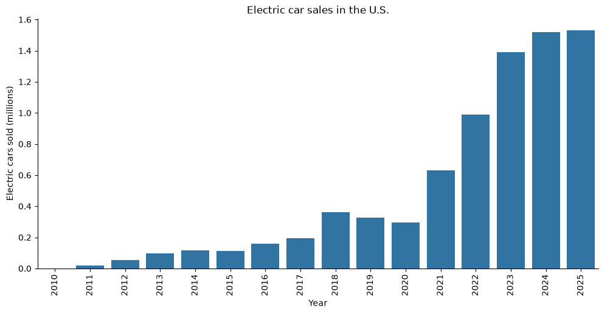
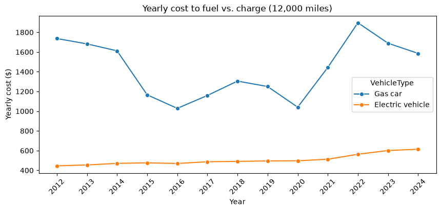
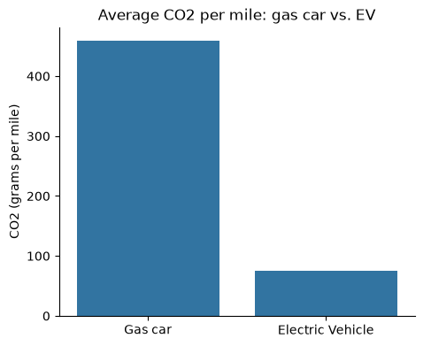

# EVs vs. Gas Cars: Cost, Emissions and Adoption in the U.S.

**In 2024, charging an EV cost about $970 less per year than fueling a gas car (about $614 vs. $1,586), and EVs produced roughly 83% less CO2 per mile.**

This project uses public energy and vehicle data to answer three questions:

1. How fast has EV adoption grown in the U.S.?
2. How do yearly fuel costs compare between EVs and gas cars?
3. How do CO2 emissions per mile compare?

## Key Findings

### 1. U.S. EV sales grew from about 1,200 in 2010 to over 1.5 million in 2025
EVs went from a rounding error to roughly 1 in 10 new cars sold, with the biggest jump between 2020 and 2023.

### 2. An EV was cheaper to fuel than a gas car every year from 2012 to 2024
EV charging costs rose slowly and steadily ($446 to $614 per year). Gas costs swung widely with fuel prices ($1,029 to $1,896 per year), so EV owners also got more predictable costs.

### 3. EVs produce about 76 g of CO2 per mile vs. about 458 g for gas cars
That is roughly 83% less, even after counting the emissions from generating the electricity.

## Data

| Source | What it provides |
|---|---|
| [EIA API](https://www.eia.gov/opendata/) | Residential electricity prices by state and U.S. gasoline prices, 2012-2024 |
| [Our World in Data](https://ourworldindata.org/electric-car-sales) | Electric and non-electric car sales by country, 2010-2025 |
| [FuelEconomy.gov](https://www.fueleconomy.gov/feg/download.shtml) | Tailpipe CO2 for 50,000+ vehicle models (EPA) |
| [Our World in Data](https://ourworldindata.org/travel-carbon-footprint) | CO2 per kilometer by travel mode, including electric cars |

## Method

- **Electricity cost:** pulled residential prices for all 50 states and DC from the EIA API, averaged them by year, and calculated a yearly cost at 0.3 kWh per mile and 12,000 miles per year.
- **Gas cost:** pulled the U.S. average price of regular gasoline and calculated a yearly cost at 25 miles per gallon and 12,000 miles per year.
- **Gas car CO2:** filtered the EPA data to regular and premium gasoline vehicles (45,000+ models) and averaged their tailpipe CO2 per mile.
- **EV CO2:** converted the Our World in Data electric car figure from grams per kilometer to grams per mile.

## Limitations

- **EV CO2 is not U.S.-specific.** The EV figure comes from UK government data, based on the UK electricity grid. The U.S. grid produces more CO2 per kWh, so a U.S. EV figure would likely be higher.
- **The CO2 numbers are not measured the same way.** The EV figure includes emissions from generating electricity, but the gas figure is tailpipe only and leaves out producing and transporting the fuel. The gas average also covers every model year since 1984, and older cars pollute more.
- **EV costs assume all charging is done at home.** Public fast charging costs much more.
- **Fixed assumptions:** 25 mpg, 0.3 kWh per mile and 12,000 miles per year for every car. State electricity prices are a simple average, not weighted by population.
- **Fuel costs only.** Purchase price, maintenance, insurance and tax credits are not included.

## Tools

Python (pandas, seaborn, matplotlib, requests), REST API, Jupyter Notebook

## How to Run

1. Install the packages: `pip install notebook pandas seaborn matplotlib requests`
2. Get a free EIA API key at https://www.eia.gov/opendata/register.php
3. Copy `.env.example` to `.env` and put your key in it
4. Run `jupyter notebook` and open `EV_Analysis.ipynb`
